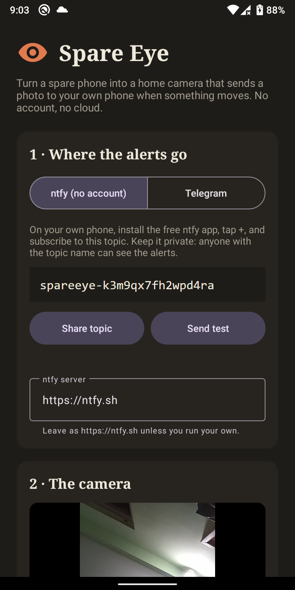
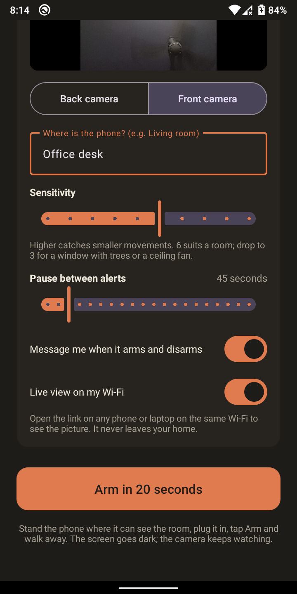
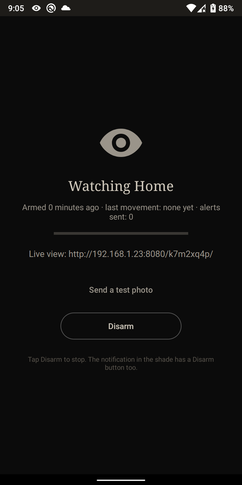
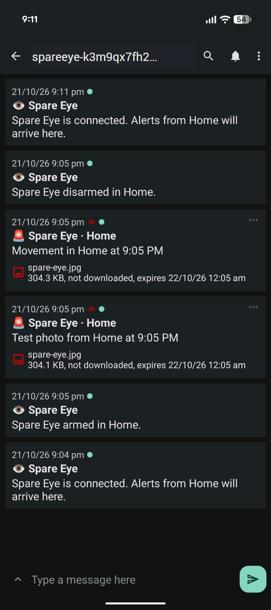

# Spare Eye

Turn the old Android phone in your drawer into a home camera that sends a photo to your own
phone when something moves. No account, no subscription, no cloud of ours. The only thing that
leaves the phone is the alert photo, sent through ntfy or to your own Telegram bot.

- **Motion alerts with a photo** on your phone within a second or two, through
  [ntfy](https://ntfy.sh) (free, no account) or Telegram.
- **Live view on your Wi-Fi**: open a link on any phone or laptop at home and see the picture.
- **Always visible**: a notification stays in the shade with a Disarm button the whole time,
  and the phone's own camera indicator lights up. It is a camera for your home, not a hidden one.
- Works on Android 8 and newer, so most phones from 2017 onwards.

<p align="center">
  <a href="https://apps.obtainium.imranr.dev/redirect?r=obtainium://add/https://github.com/mark-alexander-hub/spare-eye"></a>
  <a href="https://github.com/mark-alexander-hub/spare-eye/releases/latest"></a>
</p>

<p align="center">
  
  
  
  
</p>

## Set it up (five minutes)

1. On the spare phone, install Spare Eye with **[Obtainium](https://github.com/ImranR98/Obtainium)** (tap the badge above; it keeps the app updated from this page) or download the APK from [Releases](https://github.com/mark-alexander-hub/spare-eye/releases/latest).
2. **Alerts with ntfy (default, no account):** Spare Eye shows a random topic name like
   `spareeye-k3m9...`. On *your own* phone, install the free **ntfy** app (Play Store or
   F-Droid), tap **+**, and subscribe to that topic on `ntfy.sh`. **Share topic** sends it
   across; **Send test** checks the loop.
   **Or Telegram:** open **@BotFather**, send `/newbot`, paste the token into Spare Eye, message
   your bot once and tap **Find my chat**. (Telegram refuses new bots on some accounts; ntfy
   doesn't care.)
3. Choose back or front camera, name the room, leave sensitivity at 6.
4. Stand the phone where it can see the room, plug it in, tap **Arm in 20 seconds**, walk away.

The screen goes almost black (so the phone doesn't light the room) and shows the live-view
link. Tap **Disarm** on the screen or in the notification to stop.

## How the motion detection works

Every frame from the camera is shrunk to a few thousand sample points and compared with the
previous one. When enough of the picture changes on two frames in a row, that is movement:
the app takes a proper photo and sends it. After an alert it waits (45 seconds by default)
before it will send another, so a cat pacing the room doesn't send you 200 photos.

Sensitivity 1 only reacts to something big crossing the room; 10 catches a curtain twitching.
A ceiling fan, trees outside a window, or a TV left on will trigger it, so point the camera
away from those or drop the sensitivity.

## Live view

With "Live view on my Wi-Fi" on, the armed screen shows a link like
`http://192.168.1.23:8080/k7m2xq4p/`. It works only for devices on the same Wi-Fi, and the
random part of the link means nobody can simply guess it. Nothing is forwarded to the internet.

## Old phones run a little warm

Phones from before about 2018 often have an older camera driver (Camera "legacy" level), and
Android has to copy every frame through the graphics chip inside the app. Spare Eye asks the
camera for its slowest frame rate, which roughly halves that cost, but the phone will still use
about half a CPU core while armed. Keep it plugged in, which you'd do anyway, and it's fine.
Newer phones don't have this overhead.

## Privacy

- Settings, the ntfy topic and any bot token stay in the app's private storage on the phone.
- Photos are sent only on movement (or when you tap "Send a test photo"), and only to your
  ntfy topic or the Telegram chat you connected.
- On public ntfy.sh, **anyone who knows the topic name can read it**, so the topic is 18 random
  characters; don't post it. ntfy.sh keeps attachments for a few hours. For full control, run
  your own ntfy server and put its address in the app.
- No analytics, no crash reporting, no accounts.

## Build it yourself

Android Studio or just the command line with a JDK 17+ and the Android SDK:

```
gradlew assembleDebug
```

The APK lands in `app/build/outputs/apk/debug/`.

## Licence

MIT. Built by Mark Isidore Nicholas Alexander.
